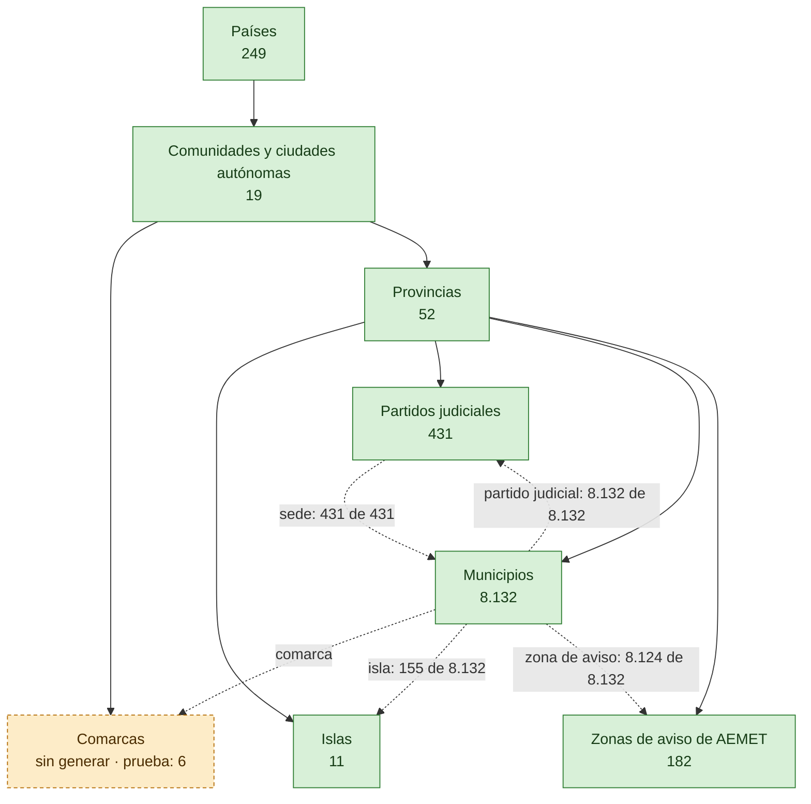
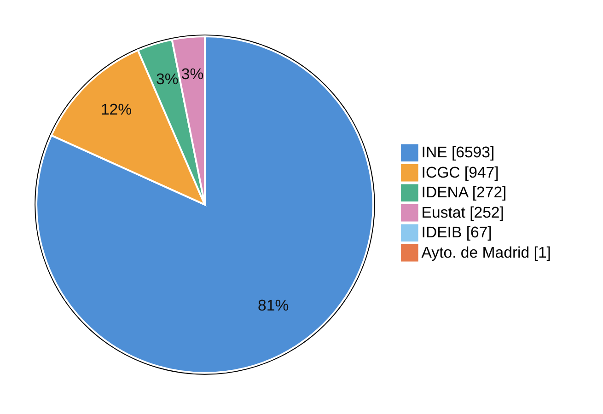
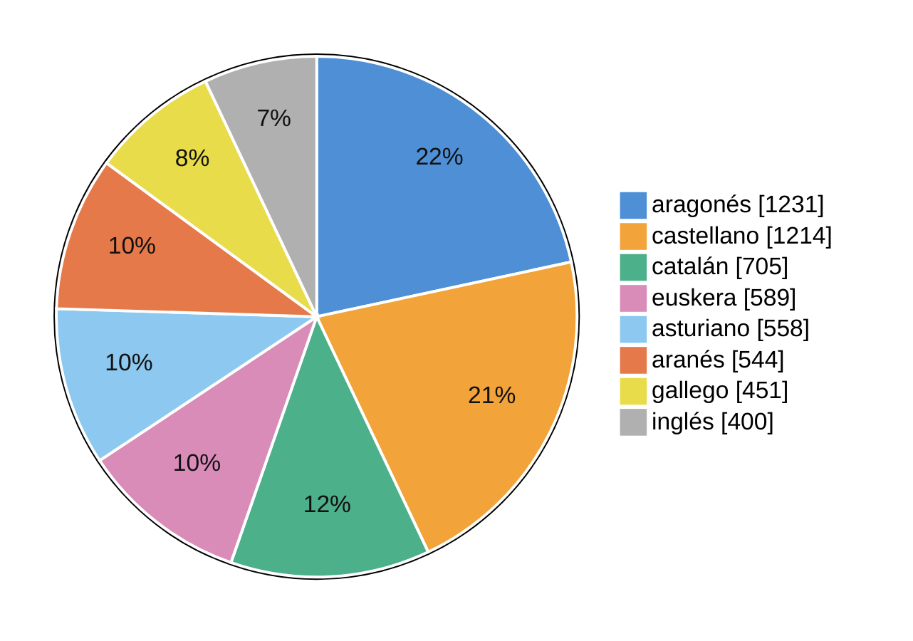
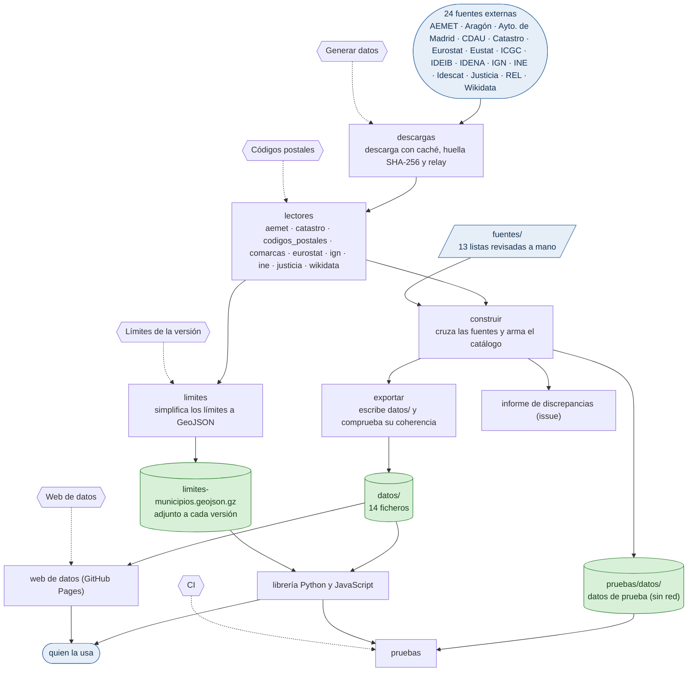
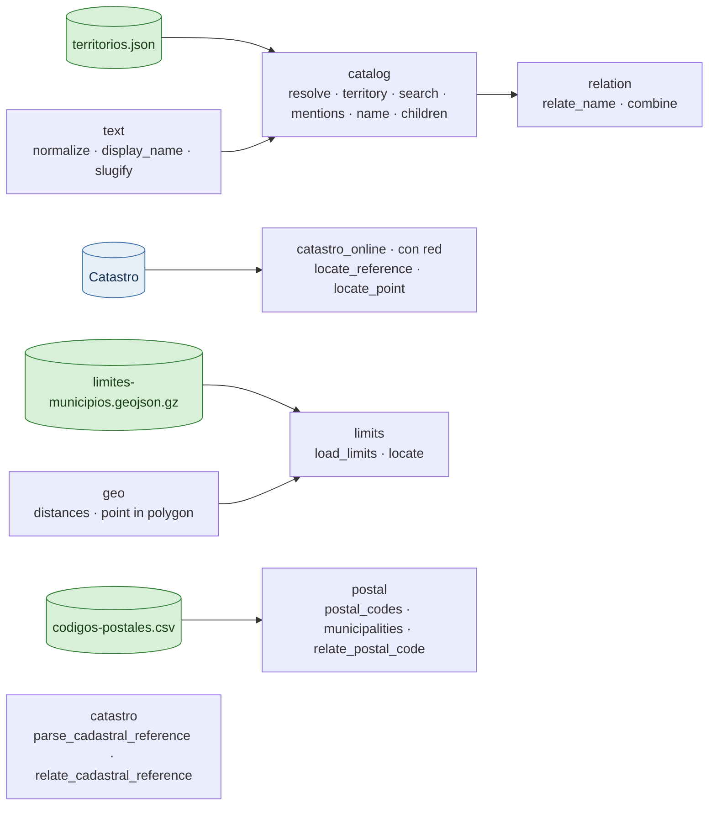

# Estado de territorios-es

Generado por `python web/estado.py` a partir de `datos/`, `pruebas/datos/` y `fuentes/`; la CI comprueba que está al día. Con pestañas y en seis idiomas, en la [web de datos](https://alertapublica.github.io/territorios-es/es/estado/). [English](status.md).

| **9.076** | **7 de 8** | **8.132** | **24** | **14.054** | **11** |
|:---:|:---:|:---:|:---:|:---:|:---:|
| territorios | niveles con datos | municipios | fuentes · descarga 2026-11-11 | pares código postal–municipio | puntos pendientes |

**Índice**: [Territorios](#territorios) · [Cobertura](#cobertura) · [Por comunidad](#por-comunidad) · [Repositorio](#repositorio) · [Fuentes](#fuentes) · [Ficheros](#ficheros) · [Librería](#librería) · [Avance](#avance)

## Territorios

Las flechas continuas van del padre al hijo; las de puntos, de un territorio a otro que enlaza en un campo, con cuántos lo tienen. En verde, lo que ya está en `datos/`; en ámbar, lo que el generador ya sabe hacer pero aún no está en `datos/` (el recuento es entonces el de los datos de prueba).

## Cobertura

Cuántos municipios tienen cada dato en `municipios.csv`. Las barras son sobre todos los municipios; algunos datos solo existen en una parte del territorio.

| Dato | Municipios | % |  |
|---|---:|---:|---|
| población (INE) | 8.132 de 8.132 | 100 % | `████████████████████` |
| partido judicial (Justicia) | 8.132 de 8.132 | 100 % | `████████████████████` |
| zona de aviso (AEMET) | 8.124 de 8.132 | 99,9 % | `███████████████████░` |
| comarca · Cataluña, Aragón, Álava y El Bierzo | sin generar |  |  |
| isla (INE) · Baleares y Canarias | 155 de 8.132 | 1,9 % | `█░░░░░░░░░░░░░░░░░░░` |
| código postal | 8.132 de 8.132 | 100 % | `████████████████████` |
| LAU (Eurostat) | 8.132 de 8.132 | 100 % | `████████████████████` |
| NUTS 3 | 8.132 de 8.132 | 100 % | `████████████████████` |
| superficie (Eurostat) | 8.132 de 8.132 | 100 % | `████████████████████` |
| código DGC (Catastro) · régimen común | 7.608 de 8.132 | 93,6 % | `███████████████████░` |
| código BDDAE y límites (IGN) | 8.132 de 8.132 | 100 % | `████████████████████` |
| capital (IGN) | 8.105 de 8.132 | 99,7 % | `███████████████████░` |
| coordenadas de la capital | 8.105 de 8.132 | 99,7 % | `███████████████████░` |
| altitud de la capital | 8.105 de 8.132 | 99,7 % | `███████████████████░` |
| Wikidata | 8.129 de 8.132 | 99,9 % | `███████████████████░` |
| OpenStreetMap | 8.121 de 8.132 | 99,9 % | `███████████████████░` |
| GeoNames | 7.991 de 8.132 | 98,3 % | `███████████████████░` |

**Fuente que decide los códigos postales (municipios)**

**Nombres por idioma de Wikidata (todos los territorios)**

## Por comunidad

| Comunidad | Municipios | Población | Partidos | Zonas de aviso | Islas | Con código postal | Fuente que decide (municipios) |
|---|---:|---:|---:|---:|---:|---:|---|
| Andalucía | 785 | 8.666.412 | 85 | 29 | — | 100 % | INE 785 |
| Aragón | 731 | 1.358.812 | 16 | 9 | — | 100 % | INE 731 |
| Principado de Asturias | 78 | 1.013.529 | 18 | 5 | — | 100 % | INE 78 |
| Illes Balears | 67 | 1.237.480 | 6 | 7 | 4 | 100 % | IDEIB 67 |
| Canarias | 88 | 2.249.976 | 19 | 13 | 7 | 100 % | INE 88 |
| Cantabria | 102 | 593.964 | 8 | 4 | — | 100 % | INE 102 |
| Castilla y León | 2.248 | 2.398.500 | 41 | 24 | — | 100 % | INE 2.248 |
| Castilla-La Mancha | 919 | 2.119.234 | 31 | 17 | — | 100 % | INE 919 |
| Cataluña | 947 | 8.146.265 | 49 | 16 | — | 100 % | ICGC 947 |
| Comunitat Valenciana | 542 | 5.415.843 | 36 | 11 | — | 100 % | INE 542 |
| Extremadura | 388 | 1.051.638 | 21 | 8 | — | 100 % | INE 388 |
| Galicia | 313 | 2.713.169 | 45 | 16 | — | 100 % | INE 313 |
| Comunidad de Madrid | 179 | 7.137.031 | 21 | 3 | — | 100 % | INE 178 · Ayto. de Madrid 1 |
| Región de Murcia | 45 | 1.589.138 | 11 | 5 | — | 100 % | INE 45 |
| Comunidad Foral de Navarra | 272 | 683.500 | 5 | 4 | — | 100 % | IDENA 272 |
| País Vasco | 252 | 2.242.342 | 14 | 7 | — | 100 % | Eustat 252 |
| La Rioja | 174 | 327.286 | 3 | 2 | — | 100 % | INE 174 |
| Ceuta | 1 | 83.595 | 1 | 1 | — | 100 % | INE 1 |
| Melilla | 1 | 86.780 | 1 | 1 | — | 100 % | INE 1 |

## Repositorio

De las fuentes a los datos y de los datos a la librería, la web y las pruebas. Los hexágonos son los workflows de GitHub Actions.

Los 5 workflows

| Workflow | Cuándo | Qué hace |
|---|---|---|
| [CI](../.github/workflows/ci.yml) | push, PR | pruebas de Python y JS, datos de prueba al día, coherencia de datos/, paquetes instalables y este mapa |
| [Generar datos](../.github/workflows/generar.yml) | a mano, programado (`17 5 3 * *`) | descarga las fuentes y regenera datos/ y este mapa; en main abre una PR y actualiza el issue del informe |
| [Códigos postales](../.github/workflows/codigos-postales.yml) | a mano, programado (`41 4 10 1,7 *`) | recopila los códigos postales de todas las fuentes, regenera este mapa y abre una PR |
| [Límites de la versión](../.github/workflows/limites.yml) | al publicar una versión | adjunta limites-municipios.geojson.gz a cada versión |
| [Web de datos](../.github/workflows/pages.yml) | push, a mano | publica la web y esta página de estado en GitHub Pages con cada cambio en main |

Los 15 módulos del generador

| Módulo | Qué hace |
|---|---|
| `aemet` | zona de aviso de cada municipio; nombre de cada zona de aviso |
| `catastro` | código DGC de cada municipio |
| `codigos_postales` | códigos postales del municipio de Madrid; códigos postales de Cataluña; códigos postales de Navarra; códigos postales del País Vasco; códigos postales de Baleares; códigos postales de toda España (callejero del censo electoral); códigos postales de Andalucía (contraste); códigos postales de los municipios de régimen común |
| `comarcas` | comarca de cada municipio de Cataluña; comarca de cada municipio de Aragón |
| `eurostat` | LAU, NUTS 3 y superficie |
| `ign` | capital de cada municipio, con coordenadas y altitud; código BDDAE y límites municipales |
| `ine` | códigos y nombres oficiales de los municipios; islas y sus municipios; cambios de nombre del año; provincias y comunidades; población oficial |
| `justicia` | partido judicial de cada municipio y su sede |
| `wikidata` | nombres por idioma, enlaces e identificadores |
| `__main__` | orquesta las descargas y escribe el informe |
| `descargas` | descarga con caché, huella SHA-256 y relay |
| `xlsx` | lee XLSX sin dependencias |
| `construir` | cruza las fuentes y arma el catálogo |
| `exportar` | escribe datos/ y comprueba su coherencia |
| `limites` | simplifica los límites a GeoJSON |

## Fuentes

Qué organismo alimenta cada fichero de `datos/`.

```mermaid
flowchart LR
  o_AEMET(["AEMET"]):::box
  o_Aragón(["Aragón"]):::box
  o_Ayto__de_Madrid(["Ayto. de Madrid"]):::box
  o_CDAU(["CDAU"]):::box
  o_Catastro(["Catastro"]):::box
  o_Eurostat(["Eurostat"]):::box
  o_Eustat(["Eustat"]):::box
  o_ICGC(["ICGC"]):::box
  o_IDEIB(["IDEIB"]):::box
  o_IDENA(["IDENA"]):::box
  o_IGN(["IGN"]):::box
  o_INE(["INE"]):::box
  o_Idescat(["Idescat"]):::box
  o_Justicia(["Justicia"]):::box
  o_REL(["REL"]):::box
  o_Wikidata(["Wikidata"]):::box
  f_codigos_postales_fuentes_csv[("codigos-postales-fuentes.csv")]:::done
  f_codigos_postales_csv[("codigos-postales.csv")]:::done
  f_codigos_csv[("codigos.csv")]:::done
  f_comarcas_csv[("comarcas.csv")]:::todo
  f_comunidades_csv[("comunidades.csv")]:::done
  f_islas_csv[("islas.csv")]:::done
  f_limites_municipios_geojson_gz[("limites-municipios.geojson.gz")]:::done
  f_municipios_csv[("municipios.csv")]:::done
  f_nombres_csv[("nombres.csv")]:::done
  f_paises_csv[("paises.csv")]:::done
  f_partidos_judiciales_csv[("partidos-judiciales.csv")]:::done
  f_provincias_csv[("provincias.csv")]:::done
  f_wikipedia_csv[("wikipedia.csv")]:::done
  f_zonas_aviso_csv[("zonas-aviso.csv")]:::done
  o_AEMET --> f_municipios_csv
  o_AEMET --> f_zonas_aviso_csv
  o_Aragón --> f_comarcas_csv
  o_Aragón --> f_municipios_csv
  o_Ayto__de_Madrid --> f_codigos_postales_fuentes_csv
  o_Ayto__de_Madrid --> f_codigos_postales_csv
  o_CDAU --> f_codigos_postales_fuentes_csv
  o_CDAU --> f_codigos_postales_csv
  o_Catastro --> f_codigos_postales_fuentes_csv
  o_Catastro --> f_codigos_postales_csv
  o_Catastro --> f_codigos_csv
  o_Catastro --> f_municipios_csv
  o_Eurostat --> f_codigos_csv
  o_Eurostat --> f_municipios_csv
  o_Eustat --> f_codigos_postales_fuentes_csv
  o_Eustat --> f_codigos_postales_csv
  o_ICGC --> f_codigos_postales_fuentes_csv
  o_ICGC --> f_codigos_postales_csv
  o_IDEIB --> f_codigos_postales_fuentes_csv
  o_IDEIB --> f_codigos_postales_csv
  o_IDENA --> f_codigos_postales_fuentes_csv
  o_IDENA --> f_codigos_postales_csv
  o_IGN --> f_limites_municipios_geojson_gz
  o_IGN --> f_municipios_csv
  o_INE --> f_codigos_postales_fuentes_csv
  o_INE --> f_codigos_postales_csv
  o_INE --> f_codigos_csv
  o_INE --> f_comunidades_csv
  o_INE --> f_islas_csv
  o_INE --> f_municipios_csv
  o_INE --> f_nombres_csv
  o_INE --> f_provincias_csv
  o_Idescat --> f_comarcas_csv
  o_Idescat --> f_municipios_csv
  o_Justicia --> f_municipios_csv
  o_Justicia --> f_partidos_judiciales_csv
  o_REL --> f_comarcas_csv
  o_REL --> f_municipios_csv
  o_Wikidata --> f_codigos_csv
  o_Wikidata --> f_nombres_csv
  o_Wikidata --> f_paises_csv
  o_Wikidata --> f_wikipedia_csv
  classDef done fill:#d8f0d8,stroke:#2e7d32,color:#173d17
  classDef todo fill:#fdecc8,stroke:#b26a00,color:#4a2c00,stroke-dasharray:4 3
  classDef box fill:#e6eef8,stroke:#3b6ea8,color:#14304f
```

Las 24 fuentes, con su lector y la fecha de descarga

| Fuente | Organismo | Lector | Aporta | Descargada |
|---|---|---|---|---|
| `ine_municipios` | INE | `generador/ine.py` | códigos y nombres oficiales de los municipios | 2026-11-11 |
| `ine_islas` | INE | `generador/ine.py` | islas y sus municipios | 2026-11-11 |
| `ine_cambios` | INE | `generador/ine.py` | cambios de nombre del año | 2026-11-11 |
| `ine_provincias` | INE | `generador/ine.py` | provincias y comunidades | 2026-11-11 |
| `ine_poblacion` | INE | `generador/ine.py` | población oficial | 2026-11-11 |
| `mjusticia_censo_judicial` | Justicia | `generador/justicia.py` | partido judicial de cada municipio y su sede | 2026-11-11 |
| `aemet_municipios` | AEMET | `generador/aemet.py` | zona de aviso de cada municipio | 2026-11-11 |
| `aemet_zonas` | AEMET | `generador/aemet.py` | nombre de cada zona de aviso | 2026-11-11 |
| `idescat_comarcas` | Idescat | `generador/comarcas.py` | comarca de cada municipio de Cataluña | aún no |
| `aragon_comarcas` | Aragón | `generador/comarcas.py` | comarca de cada municipio de Aragón | aún no |
| `rel_comarcas` | REL | `fuentes/` | comarcas que son entidad local; cuadrillas de Álava y El Bierzo (exportación revisada a mano) | aún no |
| `eurostat_lau` | Eurostat | `generador/eurostat.py` | LAU, NUTS 3 y superficie | 2026-11-11 |
| `wikidata` | Wikidata | `generador/wikidata.py` | nombres por idioma, enlaces e identificadores | 2026-11-11 |
| `catastro` | Catastro | `generador/catastro.py` | código DGC de cada municipio | 2026-11-11 |
| `ign_poblaciones` | IGN | `generador/ign.py` | capital de cada municipio, con coordenadas y altitud | 2026-11-11 |
| `ign_limites` | IGN | `generador/ign.py` | código BDDAE y límites municipales | 2026-11-11 |
| `madrid_direcciones` | Ayto. de Madrid | `generador/codigos_postales.py` | códigos postales del municipio de Madrid | 2026-11-11 |
| `icgc_direcciones` | ICGC | `generador/codigos_postales.py` | códigos postales de Cataluña | 2026-11-11 |
| `idena_direcciones` | IDENA | `generador/codigos_postales.py` | códigos postales de Navarra | 2026-11-11 |
| `eustat_portales` | Eustat | `generador/codigos_postales.py` | códigos postales del País Vasco | 2026-11-11 |
| `ideib_portales` | IDEIB | `generador/codigos_postales.py` | códigos postales de Baleares | 2026-11-11 |
| `ine_callejero` | INE | `generador/codigos_postales.py` | códigos postales de toda España (callejero del censo electoral) | 2026-11-11 |
| `cdau_portales` | CDAU | `generador/codigos_postales.py` | códigos postales de Andalucía (contraste) | 2026-11-11 |
| `catastro_direcciones` | Catastro | `generador/codigos_postales.py` | códigos postales de los municipios de régimen común | 2026-11-11 |

## Ficheros

«Explorar» abre el CSV publicado en la web con Datasette Lite: filtros, orden y consultas SQL en el navegador.

| Fichero | Filas | Tamaño | Lo alimentan | Estado |  |
|---|---:|---:|---|---|---|
| [`codigos-postales-fuentes.csv`](../datos/codigos-postales-fuentes.csv) | 33.537 | 1,7 MB | Ayto. de Madrid, CDAU, Catastro, Eustat, ICGC, IDEIB, IDENA, INE | en datos/ | [explorar](https://lite.datasette.io/?csv=https%3A%2F%2Falertapublica.github.io%2Fterritorios-es%2Fdatos%2Fcodigos-postales-fuentes.csv) |
| [`codigos-postales.csv`](../datos/codigos-postales.csv) | 14.054 | 865 KB | Ayto. de Madrid, CDAU, Catastro, Eustat, ICGC, IDEIB, IDENA, INE | en datos/ | [explorar](https://lite.datasette.io/?csv=https%3A%2F%2Falertapublica.github.io%2Fterritorios-es%2Fdatos%2Fcodigos-postales.csv) |
| [`codigos.csv`](../datos/codigos.csv) | 66.924 | 2,9 MB | Catastro, Eurostat, INE, Wikidata | en datos/ | [explorar](https://lite.datasette.io/?csv=https%3A%2F%2Falertapublica.github.io%2Fterritorios-es%2Fdatos%2Fcodigos.csv) |
| `comarcas.csv` | 6 |  | Aragón, Idescat, REL | solo en pruebas |  |
| [`comunidades.csv`](../datos/comunidades.csv) | 19 | 5 KB | INE | en datos/ | [explorar](https://lite.datasette.io/?csv=https%3A%2F%2Falertapublica.github.io%2Fterritorios-es%2Fdatos%2Fcomunidades.csv) |
| [`islas.csv`](../datos/islas.csv) | 11 | 2 KB | INE | en datos/ | [explorar](https://lite.datasette.io/?csv=https%3A%2F%2Falertapublica.github.io%2Fterritorios-es%2Fdatos%2Fislas.csv) |
| [`manifiesto.json`](../datos/manifiesto.json) |  | 21 KB |  | en datos/ |  |
| [`municipios.csv`](../datos/municipios.csv) | 8.132 | 2,2 MB | AEMET, Aragón, Catastro, Eurostat, IGN, INE, Idescat, Justicia, REL | en datos/ | [explorar](https://lite.datasette.io/?csv=https%3A%2F%2Falertapublica.github.io%2Fterritorios-es%2Fdatos%2Fmunicipios.csv) |
| [`nombres.csv`](../datos/nombres.csv) | 24.202 | 1,1 MB | INE, Wikidata | en datos/ | [explorar](https://lite.datasette.io/?csv=https%3A%2F%2Falertapublica.github.io%2Fterritorios-es%2Fdatos%2Fnombres.csv) |
| [`paises.csv`](../datos/paises.csv) | 249 | 23 KB | Wikidata | en datos/ | [explorar](https://lite.datasette.io/?csv=https%3A%2F%2Falertapublica.github.io%2Fterritorios-es%2Fdatos%2Fpaises.csv) |
| [`partidos-judiciales.csv`](../datos/partidos-judiciales.csv) | 431 | 58 KB | Justicia | en datos/ | [explorar](https://lite.datasette.io/?csv=https%3A%2F%2Falertapublica.github.io%2Fterritorios-es%2Fdatos%2Fpartidos-judiciales.csv) |
| [`provincias.csv`](../datos/provincias.csv) | 52 | 8 KB | INE | en datos/ | [explorar](https://lite.datasette.io/?csv=https%3A%2F%2Falertapublica.github.io%2Fterritorios-es%2Fdatos%2Fprovincias.csv) |
| [`territorios.json`](../datos/territorios.json) | 9.076 | 5,5 MB |  | en datos/ |  |
| [`wikipedia.csv`](../datos/wikipedia.csv) | 64.898 | 4,9 MB | Wikidata | en datos/ | [explorar](https://lite.datasette.io/?csv=https%3A%2F%2Falertapublica.github.io%2Fterritorios-es%2Fdatos%2Fwikipedia.csv) |
| [`zonas-aviso.csv`](../datos/zonas-aviso.csv) | 182 | 15 KB | AEMET | en datos/ | [explorar](https://lite.datasette.io/?csv=https%3A%2F%2Falertapublica.github.io%2Fterritorios-es%2Fdatos%2Fzonas-aviso.csv) |

Las 13 listas revisadas a mano (<code>fuentes/</code>)

| Lista | Filas | Aporta |
|---|---:|---|
| `fuentes.json` |  | URL, licencia y atribución de cada fuente |
| `comunidades.csv` | 19 | comunidades: nombre, ISO 3166-2, NUTS 2 |
| `nombres-comunidades.csv` | 114 | nombres de las comunidades en cada idioma |
| `provincias.csv` | 52 | provincias: ISO 3166-2 y NUTS 3 |
| `islas.csv` | 11 | Wikidata y NUTS 3 de cada isla |
| `comarcas.csv` | 84 | comarcas: tipo, nombre y códigos |
| `comarcas-municipios.csv` | 89 | municipios de las cuadrillas de Álava y de El Bierzo |
| `zonas-aviso.csv` | 4 | zona de los municipios que faltan en el maestro de AEMET |
| `alias.csv` | 23 | alias |
| `partes-bilingues.csv` | 147 | partes de los nombres bilingües |
| `descartes-wikidata.csv` | 5 | etiquetas de Wikidata descartadas |
| `paises-ue.csv` | 30 | países de la UE y del EEE |
| `paises-excluidos.csv` | 6 | códigos ISO que no son países |

## Librería

Los mismos módulos en Python (`python/territorios_es/`) y JavaScript (`js/`).

## Avance

- **Niveles en `datos/`**: Comunidades y ciudades autónomas, Provincias, Municipios, Islas, Partidos judiciales, Zonas de aviso de AEMET, Países.
- **Niveles hechos en el código que faltan en `datos/` (hay que lanzar «Generar datos»)**: Comarcas.

Del [apartado 13 del diseño](../docs/diseno.md#13-pendiente):

- Traducir este documento y el README al catalán, gallego, euskera y aranés
- Revisar las traducciones de la web y de los nombres de comunidades (marcadas como pendientes)
- Revisar el informe de discrepancias de la primera generación
- Permitir que Actions abra PR: es un ajuste de la organización
- Versión 0.4, por orden: población oficial del INE a 1 de enero en lugar de la de Eurostat
- Comarcas, más adelante: contrastar cada mes con la exportación del Registro de Entidades Locales
- Cruces de los partidos judiciales, como capas posteriores
- Zonas de aviso de AEMET, más adelante
- Nombres de países: siguen saliendo de Wikidata, que tiene alguna errata
- Códigos postales en Andalucía: el CDAU trae 526 pares que no tiene el INE, que decide allí
- Más adelante: entidades de población, variaciones históricas del INE
