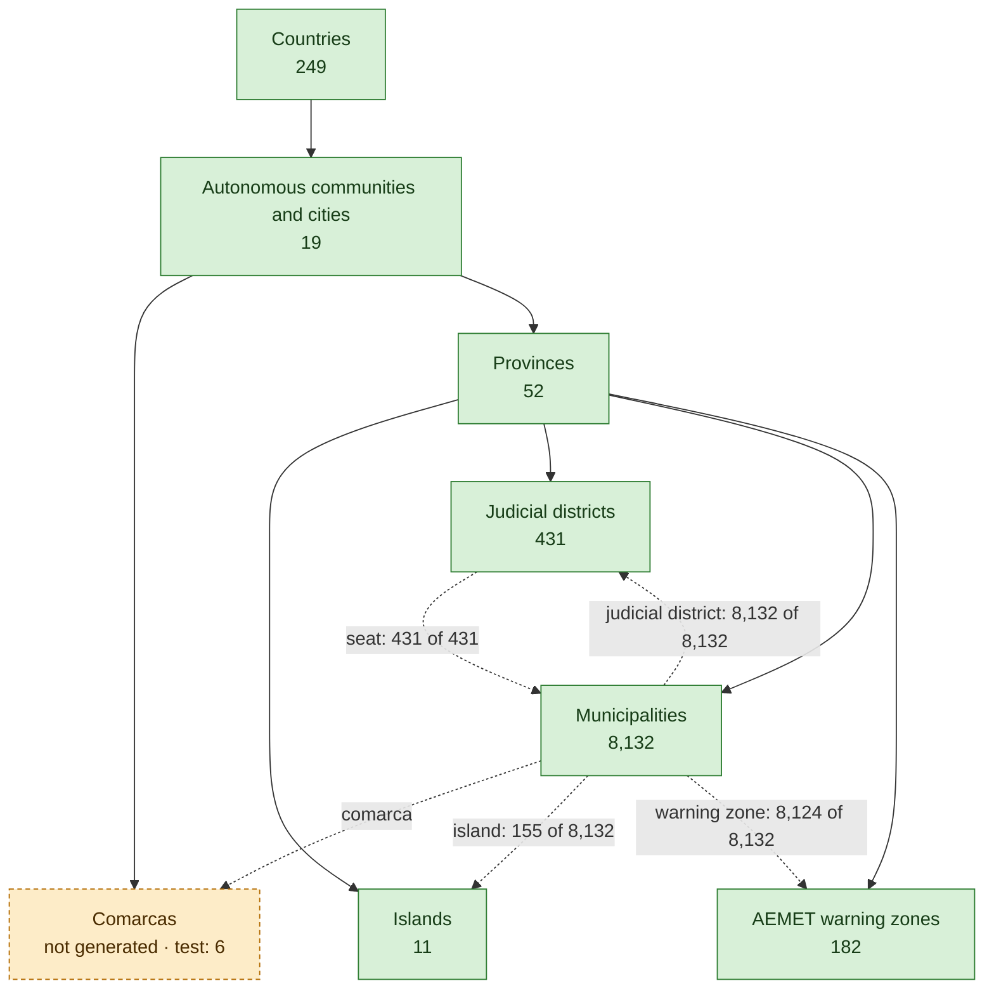
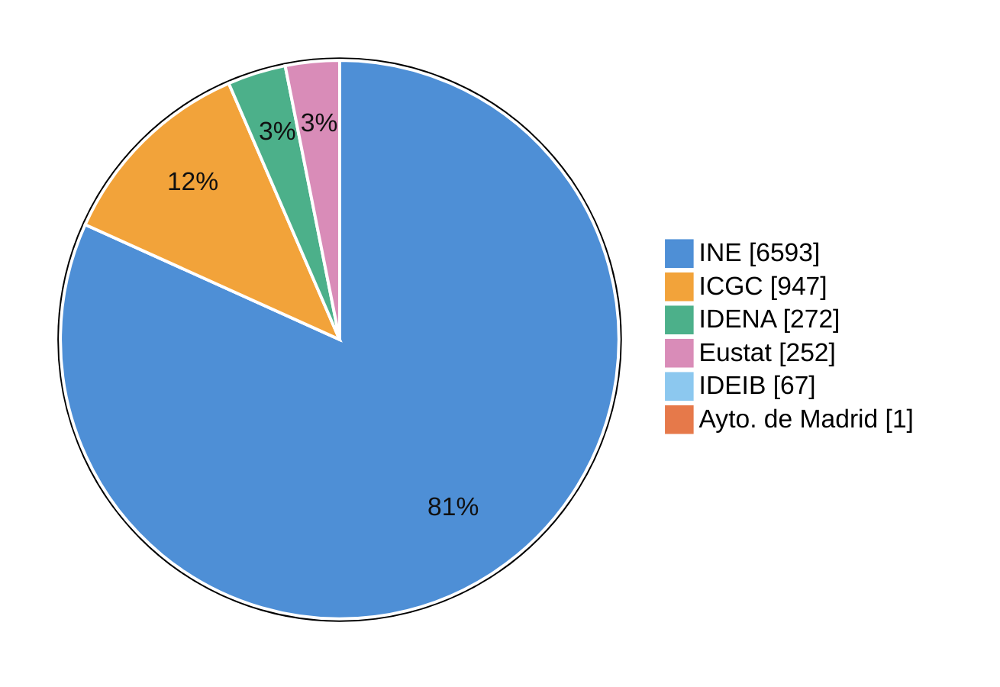
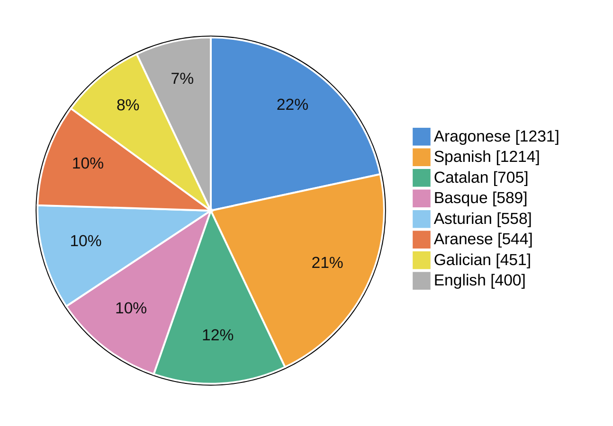
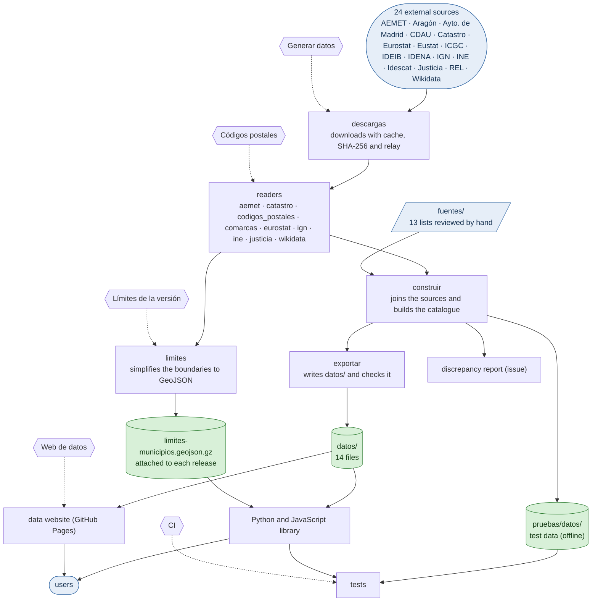
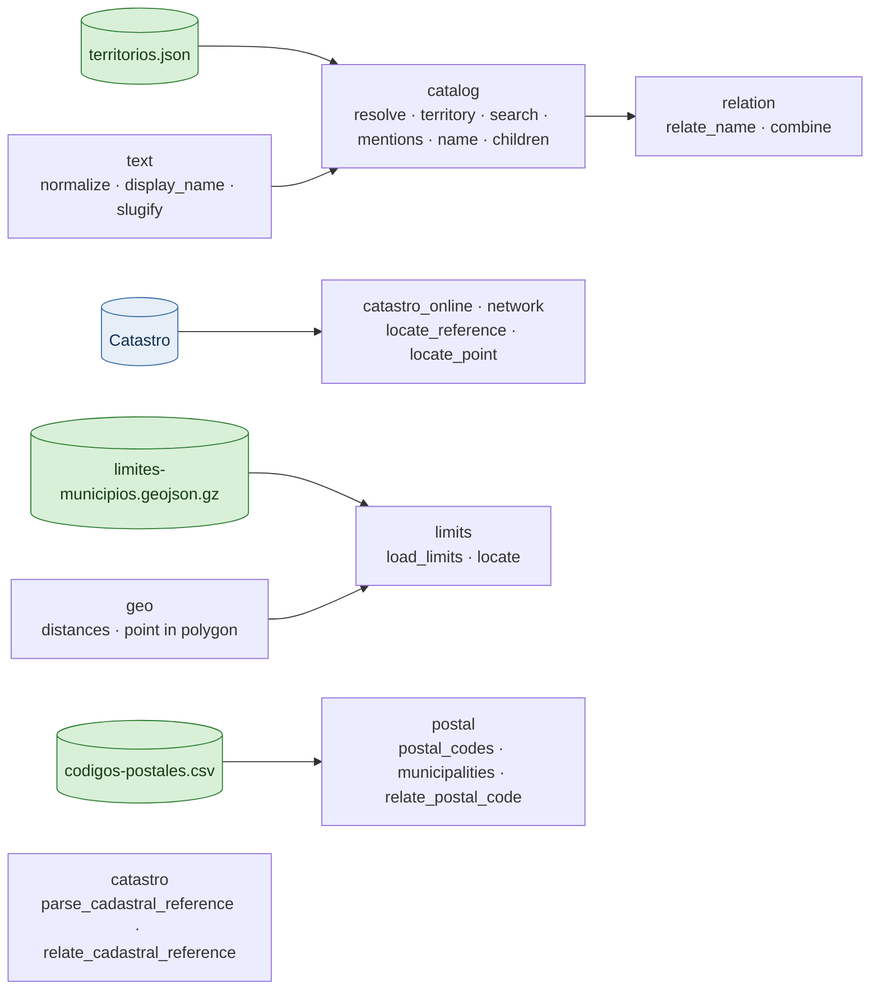

# Status of territorios-es

Generated by `python web/estado.py` from `datos/`, `pruebas/datos/` and `fuentes/`; CI checks it is up to date. With tabs and in six languages, on the [data website](https://alertapublica.github.io/territorios-es/en/estado/). [Castellano](estado.md).

| **9,076** | **7 of 8** | **8,132** | **24** | **14,054** | **11** |
|:---:|:---:|:---:|:---:|:---:|:---:|
| territories | levels with data | municipalities | sources · retrieved 2026-11-11 | postal code–municipality pairs | pending items |

**Contents**: [Territories](#territories) · [Coverage](#coverage) · [By community](#by-community) · [Repository](#repository) · [Sources](#sources) · [Files](#files) · [Library](#library) · [Progress](#progress)

## Territories

Solid arrows go from parent to child; dotted ones, from a territory to another it links in a field, with how many have it. Green: already in `datos/`; amber: the generator can build it but it is not in `datos/` yet (the count is then the test data's).

## Coverage

How many municipalities have each datum in `municipios.csv`. Bars are over all municipalities; some data only exist in part of the country.

| Datum | Municipalities | % |  |
|---|---:|---:|---|
| population (INE) | 8,132 of 8,132 | 100 % | `████████████████████` |
| judicial district (Justicia) | 8,132 of 8,132 | 100 % | `████████████████████` |
| warning zone (AEMET) | 8,124 of 8,132 | 99.9 % | `███████████████████░` |
| comarca · Catalonia, Aragon, Álava and El Bierzo | not generated |  |  |
| island (INE) · Balearic and Canary Islands | 155 of 8,132 | 1.9 % | `█░░░░░░░░░░░░░░░░░░░` |
| postal code | 8,132 of 8,132 | 100 % | `████████████████████` |
| LAU (Eurostat) | 8,132 of 8,132 | 100 % | `████████████████████` |
| NUTS 3 | 8,132 of 8,132 | 100 % | `████████████████████` |
| area (Eurostat) | 8,132 of 8,132 | 100 % | `████████████████████` |
| DGC code (Catastro) · common regime | 7,608 of 8,132 | 93.6 % | `███████████████████░` |
| BDDAE code and boundaries (IGN) | 8,132 of 8,132 | 100 % | `████████████████████` |
| capital (IGN) | 8,105 of 8,132 | 99.7 % | `███████████████████░` |
| coordinates of the capital | 8,105 of 8,132 | 99.7 % | `███████████████████░` |
| altitude of the capital | 8,105 of 8,132 | 99.7 % | `███████████████████░` |
| Wikidata | 8,129 of 8,132 | 99.9 % | `███████████████████░` |
| OpenStreetMap | 8,121 of 8,132 | 99.9 % | `███████████████████░` |
| GeoNames | 7,991 of 8,132 | 98.3 % | `███████████████████░` |

**Source that decides the postal codes (municipalities)**

**Wikidata names per language (all territories)**

## By community

| Community | Municipalities | Population | Judicial districts | Warning zones | Islands | With postal code | Deciding source (municipalities) |
|---|---:|---:|---:|---:|---:|---:|---|
| Andalusia | 785 | 8,666,412 | 85 | 29 | — | 100 % | INE 785 |
| Aragon | 731 | 1,358,812 | 16 | 9 | — | 100 % | INE 731 |
| Principality of Asturias | 78 | 1,013,529 | 18 | 5 | — | 100 % | INE 78 |
| Balearic Islands | 67 | 1,237,480 | 6 | 7 | 4 | 100 % | IDEIB 67 |
| Canary Islands | 88 | 2,249,976 | 19 | 13 | 7 | 100 % | INE 88 |
| Cantabria | 102 | 593,964 | 8 | 4 | — | 100 % | INE 102 |
| Castile and León | 2,248 | 2,398,500 | 41 | 24 | — | 100 % | INE 2,248 |
| Castilla–La Mancha | 919 | 2,119,234 | 31 | 17 | — | 100 % | INE 919 |
| Catalonia | 947 | 8,146,265 | 49 | 16 | — | 100 % | ICGC 947 |
| Valencian Community | 542 | 5,415,843 | 36 | 11 | — | 100 % | INE 542 |
| Extremadura | 388 | 1,051,638 | 21 | 8 | — | 100 % | INE 388 |
| Galicia | 313 | 2,713,169 | 45 | 16 | — | 100 % | INE 313 |
| Community of Madrid | 179 | 7,137,031 | 21 | 3 | — | 100 % | INE 178 · Ayto. de Madrid 1 |
| Region of Murcia | 45 | 1,589,138 | 11 | 5 | — | 100 % | INE 45 |
| Chartered Community of Navarre | 272 | 683,500 | 5 | 4 | — | 100 % | IDENA 272 |
| Basque Country | 252 | 2,242,342 | 14 | 7 | — | 100 % | Eustat 252 |
| La Rioja | 174 | 327,286 | 3 | 2 | — | 100 % | INE 174 |
| Ceuta | 1 | 83,595 | 1 | 1 | — | 100 % | INE 1 |
| Melilla | 1 | 86,780 | 1 | 1 | — | 100 % | INE 1 |

## Repository

From the sources to the data and from the data to the library, the website and the tests. Hexagons are the GitHub Actions workflows.

The 5 workflows

| Workflow | When | What it does |
|---|---|---|
| [CI](../.github/workflows/ci.yml) | push, PR | Python and JS tests, test data up to date, datos/ coherence, installable packages and this map |
| [Generar datos](../.github/workflows/generar.yml) | manual, scheduled (`17 5 3 * *`) | downloads the sources and rebuilds datos/ and this map; on main opens a PR and updates the report issue |
| [Códigos postales](../.github/workflows/codigos-postales.yml) | manual, scheduled (`41 4 10 1,7 *`) | collects the postal codes from every source, rebuilds this map and opens a PR |
| [Límites de la versión](../.github/workflows/limites.yml) | on release | attaches limites-municipios.geojson.gz to each release |
| [Web de datos](../.github/workflows/pages.yml) | push, manual | publishes the website and this status page on GitHub Pages with every change on main |

The 15 generator modules

| Module | What it does |
|---|---|
| `aemet` | warning zone of each municipality; name of each warning zone |
| `catastro` | DGC code of each municipality |
| `codigos_postales` | postal codes of the municipality of Madrid; postal codes of Catalonia; postal codes of Navarre; postal codes of the Basque Country; postal codes of the Balearic Islands; postal codes of all Spain (electoral census street map); postal codes of Andalusia (cross-check); postal codes of the common-regime municipalities |
| `comarcas` | comarca of each municipality of Catalonia; comarca of each municipality of Aragon |
| `eurostat` | LAU, NUTS 3 and area |
| `ign` | capital of each municipality, with coordinates and altitude; BDDAE code and municipal boundaries |
| `ine` | official codes and names of municipalities; islands and their municipalities; name changes of the year; provinces and communities; official population |
| `justicia` | judicial district of each municipality and its seat |
| `wikidata` | names per language, links and identifiers |
| `__main__` | runs the downloads and writes the report |
| `descargas` | downloads with cache, SHA-256 and relay |
| `xlsx` | reads XLSX without dependencies |
| `construir` | joins the sources and builds the catalogue |
| `exportar` | writes datos/ and checks it |
| `limites` | simplifies the boundaries to GeoJSON |

## Sources

Which organisation feeds each file of `datos/`.

```mermaid
flowchart LR
  o_AEMET(["AEMET"]):::box
  o_Aragón(["Aragón"]):::box
  o_Ayto__de_Madrid(["Ayto. de Madrid"]):::box
  o_CDAU(["CDAU"]):::box
  o_Catastro(["Catastro"]):::box
  o_Eurostat(["Eurostat"]):::box
  o_Eustat(["Eustat"]):::box
  o_ICGC(["ICGC"]):::box
  o_IDEIB(["IDEIB"]):::box
  o_IDENA(["IDENA"]):::box
  o_IGN(["IGN"]):::box
  o_INE(["INE"]):::box
  o_Idescat(["Idescat"]):::box
  o_Justicia(["Justicia"]):::box
  o_REL(["REL"]):::box
  o_Wikidata(["Wikidata"]):::box
  f_codigos_postales_fuentes_csv[("codigos-postales-fuentes.csv")]:::done
  f_codigos_postales_csv[("codigos-postales.csv")]:::done
  f_codigos_csv[("codigos.csv")]:::done
  f_comarcas_csv[("comarcas.csv")]:::todo
  f_comunidades_csv[("comunidades.csv")]:::done
  f_islas_csv[("islas.csv")]:::done
  f_limites_municipios_geojson_gz[("limites-municipios.geojson.gz")]:::done
  f_municipios_csv[("municipios.csv")]:::done
  f_nombres_csv[("nombres.csv")]:::done
  f_paises_csv[("paises.csv")]:::done
  f_partidos_judiciales_csv[("partidos-judiciales.csv")]:::done
  f_provincias_csv[("provincias.csv")]:::done
  f_wikipedia_csv[("wikipedia.csv")]:::done
  f_zonas_aviso_csv[("zonas-aviso.csv")]:::done
  o_AEMET --> f_municipios_csv
  o_AEMET --> f_zonas_aviso_csv
  o_Aragón --> f_comarcas_csv
  o_Aragón --> f_municipios_csv
  o_Ayto__de_Madrid --> f_codigos_postales_fuentes_csv
  o_Ayto__de_Madrid --> f_codigos_postales_csv
  o_CDAU --> f_codigos_postales_fuentes_csv
  o_CDAU --> f_codigos_postales_csv
  o_Catastro --> f_codigos_postales_fuentes_csv
  o_Catastro --> f_codigos_postales_csv
  o_Catastro --> f_codigos_csv
  o_Catastro --> f_municipios_csv
  o_Eurostat --> f_codigos_csv
  o_Eurostat --> f_municipios_csv
  o_Eustat --> f_codigos_postales_fuentes_csv
  o_Eustat --> f_codigos_postales_csv
  o_ICGC --> f_codigos_postales_fuentes_csv
  o_ICGC --> f_codigos_postales_csv
  o_IDEIB --> f_codigos_postales_fuentes_csv
  o_IDEIB --> f_codigos_postales_csv
  o_IDENA --> f_codigos_postales_fuentes_csv
  o_IDENA --> f_codigos_postales_csv
  o_IGN --> f_limites_municipios_geojson_gz
  o_IGN --> f_municipios_csv
  o_INE --> f_codigos_postales_fuentes_csv
  o_INE --> f_codigos_postales_csv
  o_INE --> f_codigos_csv
  o_INE --> f_comunidades_csv
  o_INE --> f_islas_csv
  o_INE --> f_municipios_csv
  o_INE --> f_nombres_csv
  o_INE --> f_provincias_csv
  o_Idescat --> f_comarcas_csv
  o_Idescat --> f_municipios_csv
  o_Justicia --> f_municipios_csv
  o_Justicia --> f_partidos_judiciales_csv
  o_REL --> f_comarcas_csv
  o_REL --> f_municipios_csv
  o_Wikidata --> f_codigos_csv
  o_Wikidata --> f_nombres_csv
  o_Wikidata --> f_paises_csv
  o_Wikidata --> f_wikipedia_csv
  classDef done fill:#d8f0d8,stroke:#2e7d32,color:#173d17
  classDef todo fill:#fdecc8,stroke:#b26a00,color:#4a2c00,stroke-dasharray:4 3
  classDef box fill:#e6eef8,stroke:#3b6ea8,color:#14304f
```

The 24 sources, with their reader and retrieval date

| Source | Organisation | Reader | Provides | Retrieved |
|---|---|---|---|---|
| `ine_municipios` | INE | `generador/ine.py` | official codes and names of municipalities | 2026-11-11 |
| `ine_islas` | INE | `generador/ine.py` | islands and their municipalities | 2026-11-11 |
| `ine_cambios` | INE | `generador/ine.py` | name changes of the year | 2026-11-11 |
| `ine_provincias` | INE | `generador/ine.py` | provinces and communities | 2026-11-11 |
| `ine_poblacion` | INE | `generador/ine.py` | official population | 2026-11-11 |
| `mjusticia_censo_judicial` | Justicia | `generador/justicia.py` | judicial district of each municipality and its seat | 2026-11-11 |
| `aemet_municipios` | AEMET | `generador/aemet.py` | warning zone of each municipality | 2026-11-11 |
| `aemet_zonas` | AEMET | `generador/aemet.py` | name of each warning zone | 2026-11-11 |
| `idescat_comarcas` | Idescat | `generador/comarcas.py` | comarca of each municipality of Catalonia | not yet |
| `aragon_comarcas` | Aragón | `generador/comarcas.py` | comarca of each municipality of Aragon | not yet |
| `rel_comarcas` | REL | `fuentes/` | comarcas that are local entities; Álava's cuadrillas and El Bierzo (export reviewed by hand) | not yet |
| `eurostat_lau` | Eurostat | `generador/eurostat.py` | LAU, NUTS 3 and area | 2026-11-11 |
| `wikidata` | Wikidata | `generador/wikidata.py` | names per language, links and identifiers | 2026-11-11 |
| `catastro` | Catastro | `generador/catastro.py` | DGC code of each municipality | 2026-11-11 |
| `ign_poblaciones` | IGN | `generador/ign.py` | capital of each municipality, with coordinates and altitude | 2026-11-11 |
| `ign_limites` | IGN | `generador/ign.py` | BDDAE code and municipal boundaries | 2026-11-11 |
| `madrid_direcciones` | Ayto. de Madrid | `generador/codigos_postales.py` | postal codes of the municipality of Madrid | 2026-11-11 |
| `icgc_direcciones` | ICGC | `generador/codigos_postales.py` | postal codes of Catalonia | 2026-11-11 |
| `idena_direcciones` | IDENA | `generador/codigos_postales.py` | postal codes of Navarre | 2026-11-11 |
| `eustat_portales` | Eustat | `generador/codigos_postales.py` | postal codes of the Basque Country | 2026-11-11 |
| `ideib_portales` | IDEIB | `generador/codigos_postales.py` | postal codes of the Balearic Islands | 2026-11-11 |
| `ine_callejero` | INE | `generador/codigos_postales.py` | postal codes of all Spain (electoral census street map) | 2026-11-11 |
| `cdau_portales` | CDAU | `generador/codigos_postales.py` | postal codes of Andalusia (cross-check) | 2026-11-11 |
| `catastro_direcciones` | Catastro | `generador/codigos_postales.py` | postal codes of the common-regime municipalities | 2026-11-11 |

## Files

«Explore» opens the CSV published on the website in Datasette Lite: filters, sorting and SQL in the browser.

| File | Rows | Size | Fed by | Status |  |
|---|---:|---:|---|---|---|
| [`codigos-postales-fuentes.csv`](../datos/codigos-postales-fuentes.csv) | 33,537 | 1.7 MB | Ayto. de Madrid, CDAU, Catastro, Eustat, ICGC, IDEIB, IDENA, INE | in datos/ | [explore](https://lite.datasette.io/?csv=https%3A%2F%2Falertapublica.github.io%2Fterritorios-es%2Fdatos%2Fcodigos-postales-fuentes.csv) |
| [`codigos-postales.csv`](../datos/codigos-postales.csv) | 14,054 | 865 KB | Ayto. de Madrid, CDAU, Catastro, Eustat, ICGC, IDEIB, IDENA, INE | in datos/ | [explore](https://lite.datasette.io/?csv=https%3A%2F%2Falertapublica.github.io%2Fterritorios-es%2Fdatos%2Fcodigos-postales.csv) |
| [`codigos.csv`](../datos/codigos.csv) | 66,924 | 2.9 MB | Catastro, Eurostat, INE, Wikidata | in datos/ | [explore](https://lite.datasette.io/?csv=https%3A%2F%2Falertapublica.github.io%2Fterritorios-es%2Fdatos%2Fcodigos.csv) |
| `comarcas.csv` | 6 |  | Aragón, Idescat, REL | only in tests |  |
| [`comunidades.csv`](../datos/comunidades.csv) | 19 | 5 KB | INE | in datos/ | [explore](https://lite.datasette.io/?csv=https%3A%2F%2Falertapublica.github.io%2Fterritorios-es%2Fdatos%2Fcomunidades.csv) |
| [`islas.csv`](../datos/islas.csv) | 11 | 2 KB | INE | in datos/ | [explore](https://lite.datasette.io/?csv=https%3A%2F%2Falertapublica.github.io%2Fterritorios-es%2Fdatos%2Fislas.csv) |
| [`manifiesto.json`](../datos/manifiesto.json) |  | 21 KB |  | in datos/ |  |
| [`municipios.csv`](../datos/municipios.csv) | 8,132 | 2.2 MB | AEMET, Aragón, Catastro, Eurostat, IGN, INE, Idescat, Justicia, REL | in datos/ | [explore](https://lite.datasette.io/?csv=https%3A%2F%2Falertapublica.github.io%2Fterritorios-es%2Fdatos%2Fmunicipios.csv) |
| [`nombres.csv`](../datos/nombres.csv) | 24,202 | 1.1 MB | INE, Wikidata | in datos/ | [explore](https://lite.datasette.io/?csv=https%3A%2F%2Falertapublica.github.io%2Fterritorios-es%2Fdatos%2Fnombres.csv) |
| [`paises.csv`](../datos/paises.csv) | 249 | 23 KB | Wikidata | in datos/ | [explore](https://lite.datasette.io/?csv=https%3A%2F%2Falertapublica.github.io%2Fterritorios-es%2Fdatos%2Fpaises.csv) |
| [`partidos-judiciales.csv`](../datos/partidos-judiciales.csv) | 431 | 58 KB | Justicia | in datos/ | [explore](https://lite.datasette.io/?csv=https%3A%2F%2Falertapublica.github.io%2Fterritorios-es%2Fdatos%2Fpartidos-judiciales.csv) |
| [`provincias.csv`](../datos/provincias.csv) | 52 | 8 KB | INE | in datos/ | [explore](https://lite.datasette.io/?csv=https%3A%2F%2Falertapublica.github.io%2Fterritorios-es%2Fdatos%2Fprovincias.csv) |
| [`territorios.json`](../datos/territorios.json) | 9,076 | 5.5 MB |  | in datos/ |  |
| [`wikipedia.csv`](../datos/wikipedia.csv) | 64,898 | 4.9 MB | Wikidata | in datos/ | [explore](https://lite.datasette.io/?csv=https%3A%2F%2Falertapublica.github.io%2Fterritorios-es%2Fdatos%2Fwikipedia.csv) |
| [`zonas-aviso.csv`](../datos/zonas-aviso.csv) | 182 | 15 KB | AEMET | in datos/ | [explore](https://lite.datasette.io/?csv=https%3A%2F%2Falertapublica.github.io%2Fterritorios-es%2Fdatos%2Fzonas-aviso.csv) |

The 13 lists reviewed by hand (<code>fuentes/</code>)

| List | Rows | Provides |
|---|---:|---|
| `fuentes.json` |  | URL, licence and attribution of each source |
| `comunidades.csv` | 19 | communities: name, ISO 3166-2, NUTS 2 |
| `nombres-comunidades.csv` | 114 | names of the communities in each language |
| `provincias.csv` | 52 | provinces: ISO 3166-2 and NUTS 3 |
| `islas.csv` | 11 | Wikidata and NUTS 3 of each island |
| `comarcas.csv` | 84 | comarcas: type, name and codes |
| `comarcas-municipios.csv` | 89 | municipalities of Álava's cuadrillas and El Bierzo |
| `zonas-aviso.csv` | 4 | zone of the municipalities missing from AEMET's list |
| `alias.csv` | 23 | aliases |
| `partes-bilingues.csv` | 147 | parts of bilingual names |
| `descartes-wikidata.csv` | 5 | discarded Wikidata labels |
| `paises-ue.csv` | 30 | EU and EEA countries |
| `paises-excluidos.csv` | 6 | ISO codes that are not countries |

## Library

The same modules in Python (`python/territorios_es/`) and JavaScript (`js/`).

## Progress

- **Levels in `datos/`**: Autonomous communities and cities, Provinces, Municipalities, Islands, Judicial districts, AEMET warning zones, Countries.
- **Levels done in code but missing from `datos/` (run «Generar datos»)**: Comarcas.

From [section 13 of the design](../docs/design.md#13-pending):

- Translate this document and the README into Catalan, Galician, Basque and Aranese
- Review the translations of the website and of the names of autonomous communities (marked as pending)
- Review the discrepancy report of the first generation
- Allow Actions to open PRs: it is an organisation setting
- Version 0.4, in order: official INE population as of 1 January instead of Eurostat's
- Comarcas, later: check them every month against the Registro de Entidades Locales export
- Cross-references of the judicial districts, as later layers
- AEMET warning zones, later: the 51 coastal ones, linked to their land zone, and their Wikidata item
- Country names: they still come from Wikidata, which has some typos
- Postal codes in Andalusia: CDAU has 526 pairs that the INE, which decides there, lacks
- Later: population entities, historical INE changes
